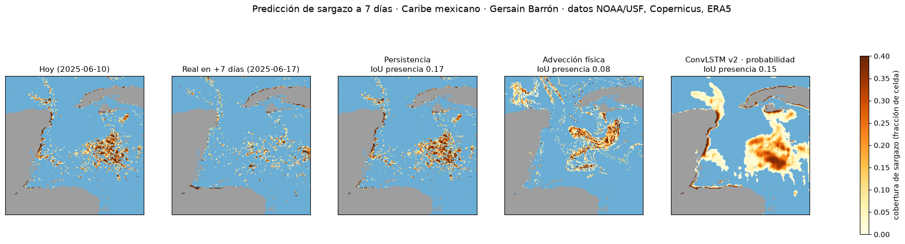

# Sargazo IA · Detector y predictor de sargazo para el Caribe mexicano

**Autor:** Gersain Barrón · [gersadesign.com](https://gersadesign.com)

🌊 **Simulador interactivo:** https://gersainbarron.github.io/sargazo-ia/

*English summary below.*

Redes neuronales que detectan el sargazo en imágenes satelitales y pronostican hacia dónde se moverá en los próximos 7 días frente a Quintana Roo, construidas solo con datos abiertos.



## Qué hace

1. **Limpia la señal satelital** (índice AFAI de NOAA/USF): quita la tierra, la franja costera y los rasgos que nunca se mueven.
2. **Detecta** el sargazo con una **U-Net** entrenada en imágenes Sentinel-2 etiquetadas (MARIDA). En prueba obtiene F1 = 0.90.
3. **Pronostica** la presencia de sargazo a 7 días con una **ConvLSTM** que combina 7 días de historia con corrientes (Copernicus Marine) y viento (ERA5).
4. **Compara con referencias honestas:** persistencia y trayectorias físicas de partículas.
5. **Lo muestra** en un simulador 3D (Three.js) con el timelapse de 2025, el pronóstico, las corrientes y un semáforo por tramo de costa.

## Resultados (prueba en 2025, temporada que el modelo no vio)

| Pronóstico a 7 días | IoU |
|---|---|
| Física simple (partículas) | 0.117 |
| Persistencia | 0.173 |
| **ConvLSTM v2** | **0.199** |

La red gana en 64 % de los días. La mejora es modesta y el análisis muestra que el límite actual es la calidad de la señal satelital, no el modelo. Ver [docs/RESULTADOS.md](docs/RESULTADOS.md).

## Documentación

- [Metodología y matemática](docs/METODOLOGIA.md)
- [Resultados](docs/RESULTADOS.md)
- [Fuentes de datos](docs/02_fuentes_de_datos.md)
- [Estado del arte](docs/03_estado_del_arte.md)
- [Arquitectura y plan](docs/04_arquitectura_y_plan.md)
- [Simulador web](docs/05_simulador_web.md)

## Estructura

```
scripts/        01–04 descarga · 05–08 limpieza y U-Net · 09–14 dataset y ConvLSTM · 15 exportación web
src/sargazo/    dataset MARIDA
web/simulador/  simulador Three.js (index.html + data/)
blender/        escena cinematográfica "Arribo" (Blender 5, Geometry Nodes)
modelos/        pesos de la ConvLSTM v2 y métricas (los pesos de la U-Net no se incluyen por tamaño)
notebooks/figuras/  figuras de resultados
```

## Reproducir

```bash
conda create -n sargazo python=3.11 -y && conda activate sargazo
pip install -r requirements.txt          # PyTorch: instalar la versión para tu GPU

python scripts/01_descargar_afai.py --inicio 2019-03-01 --fin 2019-09-30   # sin cuenta
copernicusmarine login                    # cuenta gratuita de Copernicus Marine
python scripts/02_descargar_corrientes.py --inicio 2019-03-01 --fin 2019-09-30
python scripts/03_descargar_viento.py --inicio 2019-03-01 --fin 2019-09-30 # requiere ~/.cdsapirc (CDS)
python scripts/04_descargar_marida.py

python scripts/07_entrenar_unet.py
python scripts/09_construir_dataset.py
python scripts/13_dias_atipicos.py
python scripts/14_entrenar_convlstm_v2.py
python scripts/15_exportar_web.py         # genera web/simulador/data/
```

Las credenciales de Copernicus y del CDS se guardan en la carpeta de usuario de cada quien y nunca en este repositorio.

## English summary

**Sargassum AI** detects pelagic sargassum in open satellite data and forecasts its presence 7 days ahead off Quintana Roo, Mexico.
- **Detection:** a U-Net trained on MARIDA Sentinel-2 patches reaches F1 = 0.90.
- **Forecast:** a ConvLSTM fed with sargassum maps, Copernicus currents and ERA5 winds reaches IoU 0.199 on the unseen 2025 season. Persistence scores 0.173 and Lagrangian particle tracking 0.117. The network wins on 64 % of days.
- **Main limitation:** the noise of the AFAI 7-day signal, documented in [docs/RESULTADOS.md](docs/RESULTADOS.md).
- **Viewer:** an interactive Three.js simulator shows the 2025 timelapse with forecasts, currents and per-beach risk.

## Datos y créditos

NOAA AOML / USF Optical Oceanography Lab (AFAI) · E.U. Copernicus Marine Service (GLOBAL_ANALYSISFORECAST_PHY_001_024, GLOBAL_MULTIYEAR_PHY_001_030) · Copernicus Climate Change Service, ERA5 · MARIDA (Kikaki et al., 2022).

*Propuesta independiente construida con datos abiertos; no es un producto oficial de ninguna dependencia.* Desarrollado por Gersain Barrón, con asistencia de IA.

Código bajo licencia MIT. Los datos conservan las licencias de sus fuentes.
