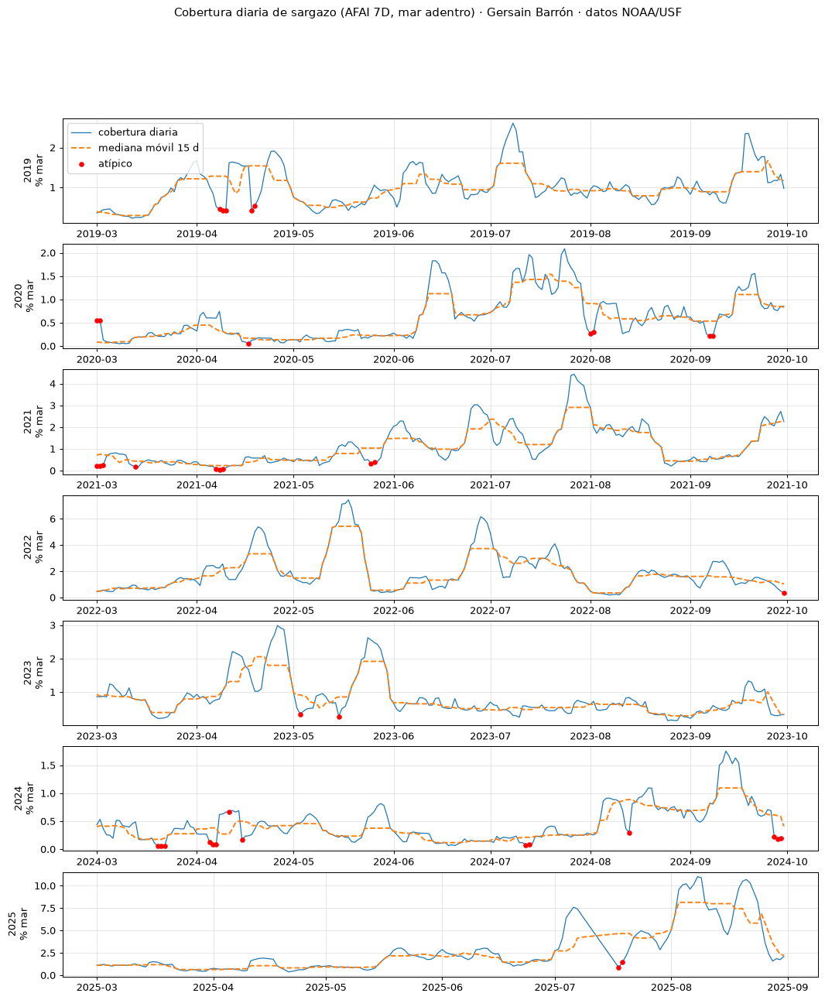
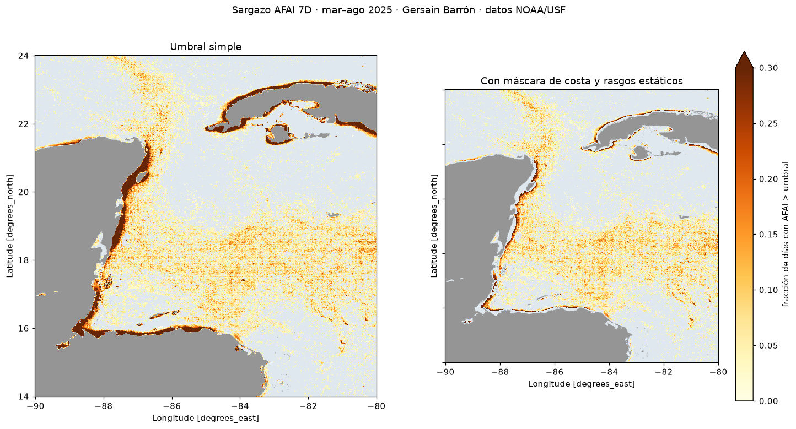
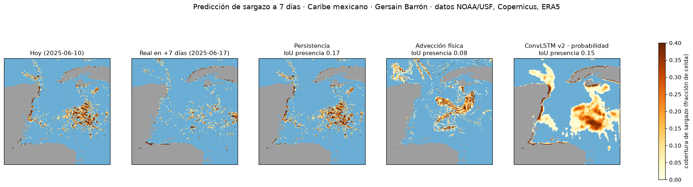

# Resultados

**Sargazo IA** · Gersain Barrón · temporada de prueba: 2025, que el modelo no vio durante el entrenamiento

## 1. Datos

| Fuente | Periodo | Resolución |
|---|---|---|
| AFAI 7D (NOAA AOML / USF) | mar–sep 2019–2025 (1,454 días) | 0.015° → celdas de ~6.7 km |
| Corrientes superficiales (Copernicus Marine) | mismo periodo, 49 meses | 1/12° |
| Viento a 10 m (ERA5) | mismo periodo, 48 meses | 0.25°, cada 6 h |
| MARIDA (Sentinel-2) | 1,381 parches de 63 escenas | 10 m |

La cobertura media por temporada fue de 1.01 % en 2019, 0.62 % en 2020, 1.13 % en 2021, 1.99 % en 2022, 0.82 % en 2023, 0.46 % en 2024 y **2.80 % en 2025**, el máximo de la serie.

## 2. Limpieza de la señal

Con un umbral simple, todas las costas aparecen "llenas de sargazo". En realidad son fondo somero y agua turbia. La máscara de costa y de rasgos estáticos elimina el 38 % de los píxeles sobre el umbral.

## 3. Detección (U-Net, MARIDA)

| Métrica (conjunto de prueba) | Valor |
|---|---|
| F1 | **0.900** |
| IoU | 0.818 |
| Precisión | 0.819 |
| Recall | 0.999 |

Encuentra prácticamente todo el sargazo, y ~18 % de lo que marca son falsos positivos. MARIDA etiqueta solo píxeles fáciles de anotar, así que en una escena completa se espera un valor menor. La cifra tampoco es comparable directamente con la literatura (Laval et al., 2023: F1 0.88, con otro conjunto y otro protocolo).

## 4. Pronóstico a 7 días

### Resumen (prueba 2025, 149 pronósticos)

| Método | IoU de presencia |
|---|---|
| Trayectorias lagrangianas (corriente + windage calibrado) | 0.117 |
| Persistencia (no cambia) | 0.173 |
| **ConvLSTM v2** | **0.199** |

La v1, entrenada como regresión con MSE, reducía el error cuadrático 39 % frente a la persistencia, pero lo lograba con un campo borroso y su IoU era de 0.189. La v2 predice la probabilidad de presencia y da zonas más definidas.

### Por día y por mes

La red supera a la persistencia en **96 de 149 días (64 %)**. La mediana diaria casi empata (0.148 contra 0.145): la ventaja media se concentra en algunos periodos.

| Mes 2025 | Pronósticos | Días que gana la red | Ventaja media de IoU |
|---|---|---|---|
| Marzo | 18 | 15 | +0.065 |
| Abril | 30 | 30 | +0.063 |
| Mayo | 31 | 15 | −0.010 |
| Junio | 30 | 6 | −0.035 |
| Julio | 9 | 3 | +0.006 |
| Agosto | 31 | 27 | +0.068 |

### Alerta por tramo de costa

| Método | F1 (TP/FP/FN) |
|---|---|
| Lagrangiano | 0.807 (389/2/184) |
| Persistencia | 0.956 (538/15/35) |
| ConvLSTM v2 | 0.981 (572/21/1) |

En 2025 hubo sargazo frente a la costa en 573 de 596 casos (96 %). Una alerta permanente obtendría F1 ≈ 0.98, así que esta métrica no distingue métodos en un año récord. Hace falta medir niveles de intensidad.

## 5. Lectura

1. **La cadena completa funciona con datos abiertos:** descarga, limpieza, detección, pronóstico, validación y visualización.
2. **La red supera a las dos referencias.** La mejora es real pero modesta (+15 % de IoU sobre la persistencia) y no es uniforme a lo largo de la temporada.
3. **La física simple pierde contra la persistencia** aun con el windage calibrado. A esta escala, buena parte de la señal AFAI no se comporta como sargazo a la deriva.
4. **El límite principal es la señal de entrada.** El AFAI 7D tiene pulsos sincronizados en toda la región, que apuntan a condiciones de observación (brillo solar, nubes, el compuesto de 7 días), además de ruido casi fijo cerca de la costa y ruido "sal y pimienta" a escala de celda.

## 6. Siguiente fase

- Mapas diarios más limpios con la U-Net aplicada a Sentinel-2 y Sentinel-3 en lugar del AFAI.
- Objetivo agregado a ~20 km para quitar el ruido de celda.
- Alerta por playa con niveles de intensidad, validada con los registros de recolección de SEMARNAT.
- Pronóstico operativo con corrientes y viento pronosticados, no analizados (en esta prueba retrospectiva se usaron los análisis, lo que da una cota optimista).
